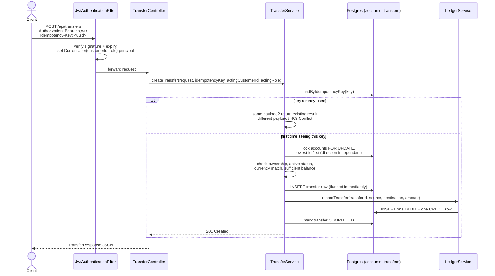

# Architecture

## Package layout

Package-by-feature, not by technical layer — everything a feature needs (entity, repository,
service, controller, DTOs, exceptions) lives together, so understanding "how transfers work"
means reading one folder, not jumping between `controllers/`, `services/`, `repositories/`
packages that each contain every feature mixed together.

```
com.leannebyrne.bank
├── customer/   Customer, Role, repository, service, controller, DTOs
├── account/    Account, AccountType/Status, locking repository, service, controller, DTOs
├── transfer/   Transfer, TransferStatus, service (the core money-movement logic), controller
├── ledger/     LedgerEntry, EntryType, append-only repository, LedgerService
├── security/   SecurityConfig, JwtService/Filter, AuthController, CurrentUser principal
└── common/     GlobalExceptionHandler, BankingException, OwnershipException
```

## Request flow: making a transfer

This is the path that matters most, since it's where correctness under concurrency actually
gets tested — two different customers' requests can be racing for the same account's money at
the same instant, and the system has to get that right every time, not just usually.



### Why the lock order matters

Accounts are always locked **lowest-UUID-first**, regardless of which account is the source and
which is the destination. Without this, two transfers moving money in opposite directions
between the same two accounts could deadlock: transfer A locks account 1 then waits for account
2, while transfer B locks account 2 then waits for account 1 — neither can proceed. Locking in a
fixed order means both transfers always compete for the same account first, so one simply waits
for the other instead of both waiting forever.

### Why the balance check happens where it does

The balance check happens **after** both accounts are locked, immediately before any row is
written — not earlier. Checking balance before taking the lock would leave a window where a
second transfer could read the same "sufficient funds" balance and also proceed, and now two
transfers have both validated against money that only exists once. The lock has to be held
across the check-then-write, or the check proves nothing.

### Why idempotency has two layers

The idempotency lookup at the start handles the common case (a client retries the same request).
The `idempotency_key` column's database-level `UNIQUE` constraint is the backstop for the rare
case: two requests with the same key arriving at nearly the same instant, both passing the
initial lookup before either has inserted its row. Whichever insert loses that race gets a
constraint violation, which is caught and turned into "look up what the winner did and return
that" rather than a raw 500 error.

## Error handling

Business-rule failures (insufficient funds, ownership violations, account not found, etc.) are
thrown as typed `BankingException` subclasses and converted to [RFC 7807](https://www.rfc-editor.org/rfc/rfc7807)
`ProblemDetail` responses by a single `@RestControllerAdvice`. Framework-level failures (a
malformed request body, a missing required header) get the same `ProblemDetail` shape for free
via Spring's built-in support — one consistent error format everywhere, not one shape for "my
code" and another for "the framework's code."

Authentication and authorization failures that happen in the security filter chain — before a
request ever reaches a controller — are handled separately, by a custom
`AuthenticationEntryPoint` (401) and `AccessDeniedHandler` (403) registered directly on
`SecurityConfig`, writing the same `ProblemDetail` JSON shape so a client can't tell the
difference between "the filter rejected you" and "the service rejected you" just from the
response format.

## What's deliberately not derived from anything stored

There is no `balance` column anywhere in this schema. `AccountService.getBalanceCents` sums
every `ledger_entries` row for that account (credits minus debits) on read. It costs a query
instead of a column read, which is the right trade for a ledger system: a stored balance can
disagree with the history that's supposed to explain it; a derived one can't, by construction.
See [ADR 0002](decisions/0002-ledger-derived-balances.md).
